# 📡 Customer Churn Early-Warning Dashboard
### *Enterprise Churn Prediction with XGBoost, TreeSHAP Explainability & Grounded Generative AI Retention Advice*

[](https://www.python.org/)
[](https://xgboost.readthedocs.io/)
[](https://shap.readthedocs.io/)
[](https://streamlit.io/)
[](https://ai.google.dev/)
[](LICENSE)

---

## 🎯 Executive Overview

In the telecommunications sector, customer acquisition costs **5x to 7x more** than retention, with annual churn rates averaging **20% to 30%**. Most providers operate reactively: attempting to retain a customer only after a cancellation request has been filed.

This project delivers an end-to-end **Customer Churn Early-Warning System** that proactively identifies accounts at risk of defection 30–60 days before contract expiration, pinpoints root-cause drivers using game-theoretic explainability (TreeSHAP), optimizes decision cutoffs based on direct financial costs, and uses Generative AI (Google Gemini 2.5 Flash) to prescribe personalized, grounded retention strategies for frontline staff.

---

## 🏗️ System Architecture

```mermaid
flowchart TD
    subgraph Data Layer
        A[Raw Telco Dataset 7,043 Rows] --> B[Data Cleaning & Whitespace Stripping]
        B --> C['TotalCharges' Repair 0-Tenure to $0.00]
        C --> D[Strict 80/20 Stratified Train/Test Split]
    end

    subgraph Feature Pipeline
        D --> E[ColumnTransformer Fitted ONLY on Train]
        E --> F[StandardScaler for Continuous]
        E --> G[OneHotEncoder drop='first' for Categoricals]
    end

    subgraph Modeling & Economics
        F & G --> H[Baseline: Balanced Logistic Regression]
        F & G --> I[Champion: Tuned XGBoost scale_pos_weight=2.77]
        I --> J[5-Fold Stratified Cross-Validation]
        I --> K[Asymmetric Cost Curve $20 Offer vs $500 Churn Loss]
        K --> L[Optimal Decision Threshold t=0.11-0.31]
    end

    subgraph Explainability & GenAI
        I --> M[TreeSHAP Exact Polynomial Decomposition]
        M --> N[Global Macro Driver Importance]
        M --> O[Local Customer Top 3 Drivers]
        O --> P[Grounded LLM Advisor Gemini 2.5 Flash]
        P --> Q[2-Sentence Summary + 1 Retention Action]
    end

    subgraph Delivery & Action
        L & N & Q --> R[Interactive 3-Page Streamlit App]
        R --> S[Priority Queue & 1-Click Dialer CSV Export]
    end
```



---

## 🏆 Model Evaluation Benchmark

Evaluated on an identical, strictly isolated test cohort ($n = 1,409$, 26.54% churn rate):

| Metric | Baseline (Logistic Regression) | Tuned XGBoost (`scale_pos_weight`) | Business Impact |
| :--- | :---: | :---: | :--- |
| **ROC-AUC** | 0.8417 | **0.8460** | Consistently superior ranking across all decision thresholds |
| **PR-AUC (Primary)** | 0.6331 | **0.6650** | **+3.2 points (+5.0%)** improvement in minority class precision-recall |
| **Recall (@0.50)** | 78.34% | **79.68%** | Captures 8 out of every 10 leaving customers |
| **Precision (@0.50)** | 50.43% | **51.65%** | Minimizes wasted retention marketing budget |
| **F1-Score** | 0.6136 | **0.6267** | Optimal harmonic balance |
| **Accuracy** | 73.81% | **74.80%** | Baseline accuracy |

*Note: In imbalanced churn prediction, Accuracy is deceptive (a naive model predicting "Nobody Churns" yields 73.5% accuracy but zero business value). We focus on PR-AUC, Recall, and Financial Net Value.*

---

## 💰 Business Impact & Cost-Benefit Threshold Optimization

Standard machine learning models apply a default probability threshold of $P \ge 0.50$, implicitly assuming that a false alarm costs the same as a missed defection. 

In enterprise retention, costs are severely asymmetric:
- **False Negative (Missed Churner)**: Lost Customer Lifetime Value = **-$500**
- **False Positive (Unnecessary Offer)**: Promotional Campaign Outreach = **-$20**
- **True Positive (Intervened Churner)**: **-$20 offer + 50% retention success**

```
---------------------------------------------------------------------------
FINANCIAL COMPARISON: Standard vs. Cost-Optimal Threshold
---------------------------------------------------------------------------
Baseline Inaction Cost (All 374 Churners Lost):    $187,000
Cost at Standard 0.50 Threshold:                   $124,460
   (TP: 296, FP: 277, FN: 78 missed churners)

Cost at Optimal Cutoff (t ≈ 0.11 - 0.31):          $115,880
   (TP: 366, FP: 653, FN: 8 missed churners)

NET DIRECT SAVINGS ON TEST COHORT:                 $8,580
---------------------------------------------------------------------------
```

**Enterprise Scale**: Shifting from the arbitrary 0.50 cutoff to the cost-optimal cutoff saves **$8,580 on just 1,400 customers**. Scaled across an active base of 100,000 subscribers, this single tuning step yields **~$608,000 in bottom-line cash savings annually** with zero additional engineering cost.

---

## 🔍 Game-Theoretic SHAP & Grounded AI Retention Advisor

### 1. Global Macro Insights (TreeSHAP)
- **Month-to-month contracts** dominate churn risk (+0.55 mean SHAP), representing 88% of all churn events.
- **Tenure** acts as the primary retention buffer; customers who survive past 24 months drop from 47% churn down to 14%.
- **Fiber Optic service** experiences 41.9% churn when unbundled with Tech Support or Online Security.

### 2. Local Micro Accountability & Generative AI Briefings
For any flagged customer, the dashboard extracts the top 3 algorithmic drivers and feeds them to **Google Gemini 2.5 Flash** with strict anti-hallucination guardrails:

> **Customer `5178-LMXOP` (Predicted Churn Risk: 95.9%)**  
> **Executive Summary:** *Customer 5178-LMXOP exhibits a 95.9% churn risk primarily driven by being on a flexible month-to-month contract with zero long-term commitment and low 1-month tenure. This vulnerability is compounded by high-tier Fiber Optic charges, signaling frustration with price-to-service alignment.*  
>  
> **Recommended Intervention:**  
> *Retention Action: Offer a 1-year loyalty contract upgrade featuring a 20% bill discount for the first 3 months plus complimentary speed tier boost.*

*(The app includes a zero-downtime Grounded Domain Rule Engine for 100% offline functionality if no API key is provided).*

---

## 🖥️ Streamlit Interactive Application

The web interface (`app.py`) provides three functional pages:

1. **📋 Page 1: Risk-Ranked Priority Customer Queue**:
   - Filterable customer table sorted by churn probability.
   - Demographic and contract filters (Month-to-month, Fiber optic, High Risk).
   - 1-Click CSV export for direct CRM and auto-dialer integration.
2. **🔍 Page 2: Customer Deep-Dive, SHAP & AI Retention Advisor**:
   - Customer search with instant KPI profile cards.
   - Interactive Plotly SHAP waterfall chart (red = risk drivers, blue = retention anchors).
   - Grounded Generative AI executive summary and retention offer.
3. **📊 Page 3: Segment Overview & Business Cost Matrix**:
   - Interactive threshold simulator with dynamic offer cost and churn loss sliders.
   - Cohort distributions by contract, tenure, and monthly charges.
   - Model benchmark evaluation tables.

---

## 🚀 Quickstart Guide

### 1. Clone & Set Up Virtual Environment

```powershell
# Clone the repository
git clone https://github.com/omjoshi100/TelcoCustomerChurnDashboard.git
cd TelcoCustomerChurnDashboard

# Create and activate virtual environment
python -m venv .venv

# Windows
.\.venv\Scripts\Activate.ps1

# Linux / macOS
source .venv/bin/activate
```

### 2. Install Dependencies

```powershell
pip install -r requirements.txt
```

### 3. Run the End-to-End Pipeline (CLI)

```powershell
python run_pipeline.py
```
*Executes data loading, cleaning, baseline training, XGBoost tuning, cross-validation, cost curve optimization, TreeSHAP caching, and sample LLM advice generation in ~5 seconds.*

### 4. Launch the Interactive Dashboard

```powershell
streamlit run app.py
```
Open your browser at `http://localhost:8501`.

### 5. Generate the PowerPoint Slide Deck

```powershell
python presentation/generate_deck.py
```
*Generates `presentation/Telco_Churn_AI_Dashboard.pptx` ready for executive presentations.*

---

## ☁️ Deploying to Streamlit Community Cloud

1. Fork or push this repository to your GitHub account (`omjoshi100/TelcoCustomerChurnDashboard`).
2. Visit [share.streamlit.io](https://share.streamlit.io/) and log in with GitHub.
3. Click **"New app"**, select this repository, set the branch to `main`, and main file to `app.py`.
4. (Optional) In **Advanced Settings $\rightarrow$ Secrets**, add:
   ```toml
   GEMINI_API_KEY = "your-gemini-api-key"
   ```
5. Click **"Deploy!"** — your app is live on a public HTTPS URL!

---

## 📚 Project Documentation Catalog

| Document | Description |
| :--- | :--- |
| **[`step_by_step_guide/`](step_by_step_guide/)** | Complete 9-part tutorial folder covering setup, data, EDA, modeling, cost matrix, SHAP, LLMs, and deployment |
| **[`docs/PROJECT_REPORT.md`](docs/PROJECT_REPORT.md)** | Comprehensive 360-degree executive and technical project report |
| **[`docs/IN_N_OUT_OF_PROJECT.md`](docs/IN_N_OUT_OF_PROJECT.md)** | Technical blueprint: architecture, data flows, math formulations, edge cases, and defenses |
| **[`docs/PROJECT_QNA.md`](docs/PROJECT_QNA.md)** | Comprehensive Q&A covering business, data, modeling, explainability, and operations |
| **[`docs/INTERVIEW_QUESTIONS_AND_ANSWERS.md`](docs/INTERVIEW_QUESTIONS_AND_ANSWERS.md)** | 13+ rigorous technical Data Science and ML Engineering interview questions with model answers |
| **[`docs/FILE_AND_FOLDER_CATALOG.md`](docs/FILE_AND_FOLDER_CATALOG.md)** | Line-by-line manifest and purpose for every file in the repository |
| **[`presentation/`](presentation/)** | 12-slide presentation outline and automated PowerPoint (`.pptx`) deck |

---

## 👤 Author & Contact

**Om Joshi**  
- **GitHub**: [@omjoshi100](https://github.com/omjoshi100)  
- **Project**: Telco Customer Churn Early-Warning System  
- **License**: MIT Open Source License
